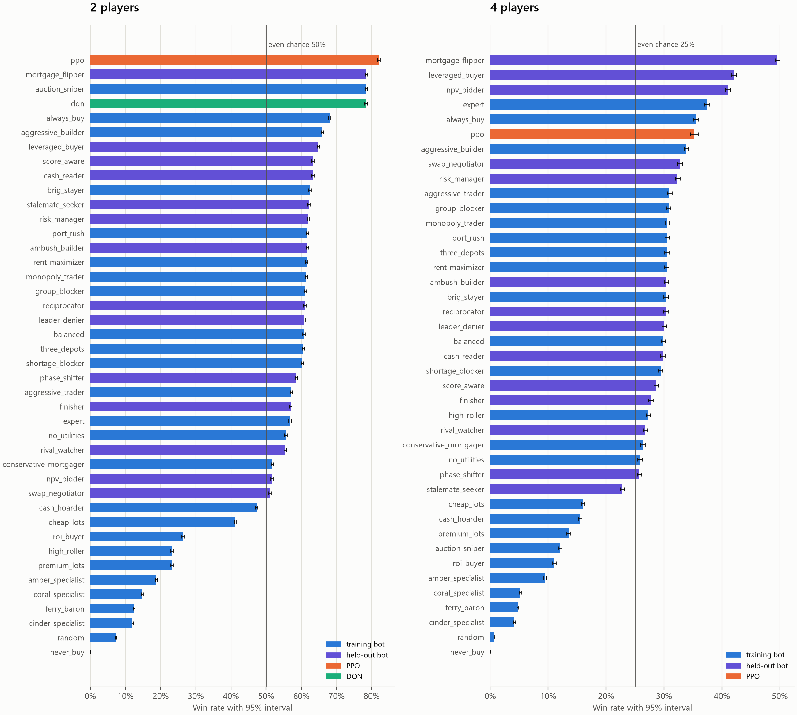
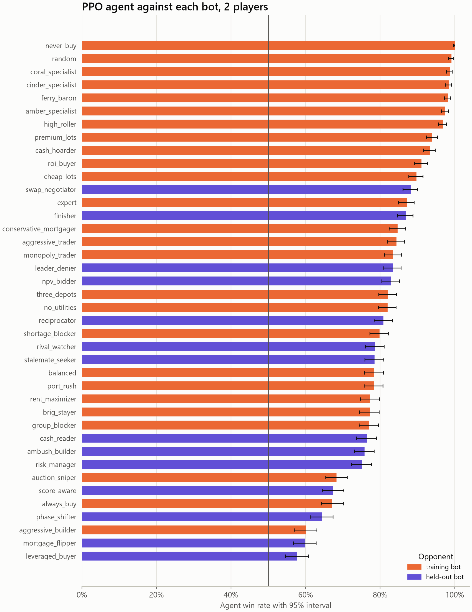
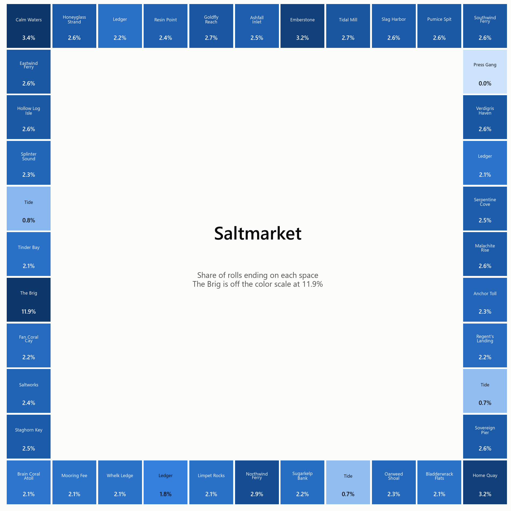
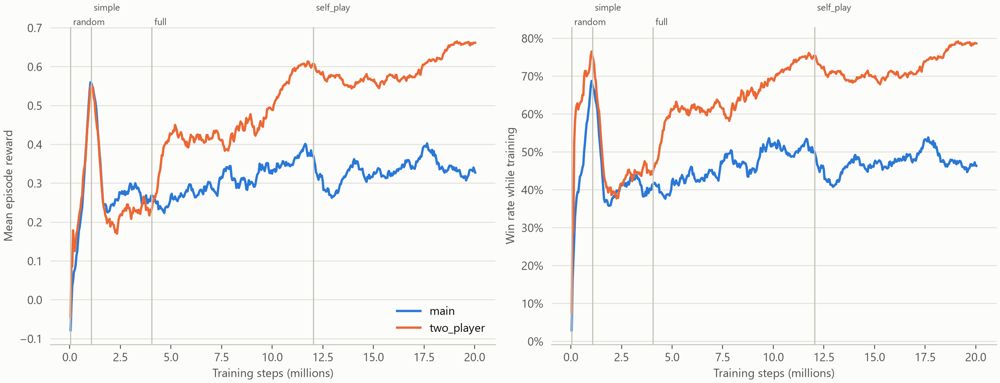
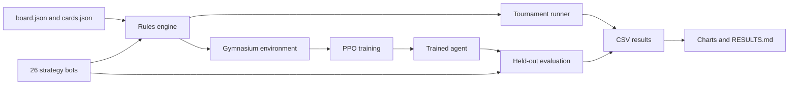

# Saltmarket AI

A Monte Carlo strategy simulator and reinforcement-learning agent for Saltmarket, an
original Monopoly-style island-trading board game. A tested Python rules engine runs
180,000 games between 26 strategy bots to measure which strategies win and why. A PPO agent
written from scratch in PyTorch then learns to play from its own experience.

**Headline result:** the 2-player agent won **85.6%** of 10,400 held-out games (95% CI
84.9–86.2) against the 26 bots, ahead of the best bot at 83.4% and winning head-to-head
against all of them. It missed its 90% target. At 4 players no agent clearly leads. Full
findings and limitations are in [RESULTS.md](RESULTS.md).



| | |
| --- | --- |
|  |  |



## Quickstart

Needs Python 3.12 or newer. Training uses an NVIDIA GPU by default, and `--device cpu`
runs it without one.

```powershell
python -m venv .venv
.\.venv\Scripts\Activate.ps1
pip install -r requirements.txt
pip install -e ".[dev]"

ruff check .                                          # lint
pytest -m smoke                                       # fast tests
pytest                                                # everything, about 5 minutes

python scripts/simulate.py                            # 180,000-game tournament
python scripts/train.py --steps 20000000 --run main   # train an agent
python scripts/evaluate.py --run main                 # held-out evaluation
python scripts/analyze.py --runs main --best-run main # charts and tables

python scripts/reproduce_all.py --quick               # whole pipeline, about 3 minutes
python scripts/reproduce_all.py                       # all results, over an hour
```

`--quick` writes to `quick_output/`, so it never changes the real results. Its numbers are
too small to mean anything. It only proves the pipeline runs.

## Architecture



The engine calls strategies directly, so a bot is a small class with decision hooks. The
environment runs each game on a worker thread and pauses it at every decision, which lets
the same engine serve both tournaments and reinforcement learning.

## Project structure

```
src/saltmarket/
  engine/    board, cards, dice, rules, bank, trades, game loop, invariants, Markov model
  bots/      base Strategy, HeuristicBot, and the 26 named bots
  sim/       fuzz testing, landing simulation, resumable tournaments
  rl/        action and observation encoding, environment, PPO, training, evaluation
  analysis/  statistics, behavior probes, charts
scripts/     command-line entry points
tests/       333 tests
data/        the original board and cards
results/     summary tables and figures
models/      trained agent weights
docs/        strategies.md, rl.md, RESUME_UPDATE.md
```

## Testing

- **Unit tests** cover each rule, including edge cases like bankruptcy partway through a
  card and building during a shortage.
- **Invariants** are checked after every turn in debug mode: money only moves through the
  bank, each space has one owner, building supply is conserved, and building stays even.
  Separate tests tamper with the state to prove the checks catch problems.
- **Fuzz tests** play 10,000 random-bot games, plus 1,000 mixed-table games per bot.
- **Property tests** use Hypothesis to try unusual game settings.
- **Independent check:** simulated landing rates match an exact Markov chain calculation
  over 1.8 million rolls.
- **PPO check:** the training code must solve CartPole before it is trusted on this game.
- **CI** runs ruff and all non-slow tests on every push.

## Tech stack

Python, NumPy, pandas, matplotlib, PyTorch, Gymnasium, pytest, Hypothesis, ruff, GitHub
Actions.

## More

- [RESULTS.md](RESULTS.md): findings, methodology, and limitations
- [docs/strategies.md](docs/strategies.md): what each bot tries to do
- [docs/rl.md](docs/rl.md): observation, actions, rewards, and training

## License

MIT. See [LICENSE](LICENSE). Saltmarket is an original game and is not affiliated with
Monopoly or its owners.
