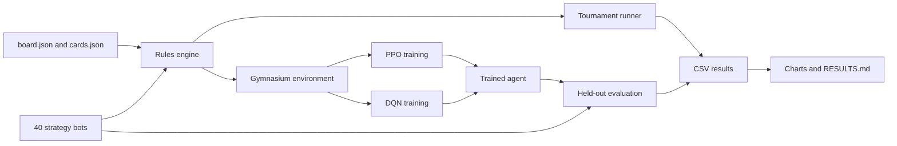
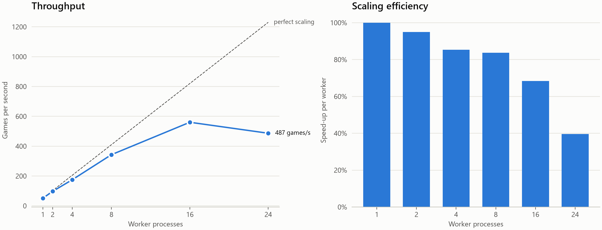

# Saltmarket AI

A Monte Carlo strategy simulator and reinforcement-learning agents for Saltmarket, an
original Monopoly-style island-trading board game. A tested Python rules engine runs
2,060,000 games between 40 strategy bots to measure which strategies win and why. PPO and
Double DQN agents, written from scratch in PyTorch, then learn to play from their own
experience. 14 of the 40 bots are held out: no agent ever trained against them.

**Headline results** at 2 players, with 95% intervals. Agents played 1,000 games against
each bot. The bot row comes from the tournament, 2,000 games per pair:

| | Against the 26 training bots | Against the 14 unseen bots |
| --- | --- | --- |
| PPO agent | **85.6%** (CI 85.1–86.0) | **75.4%** (CI 74.7–76.1) |
| DQN agent | 81.4% (CI 81.0–81.9) | 72.5% (CI 71.8–73.3) |
| Best training bot, `auction_sniper` | 83.2% (CI 82.8–83.5) | 70.0% (CI 69.4–70.5) |

- PPO is the strongest of 41 entrants at 2 players and beats every bot head-to-head. It
  missed its original 90% target.
- PPO beats DQN by 3.7 points on the identical 40,000 games (paired McNemar test,
  p = 2.4 × 10⁻⁵¹), and DQN took twice as long to train.
- At 4 players no agent clearly leads.

Full findings and limitations are in [RESULTS.md](RESULTS.md). Changes since version 1.0
are in [CHANGELOG.md](CHANGELOG.md), and the plan they followed is in
[docs/ROADMAP.md](docs/ROADMAP.md).


| | |
| --- | --- |
|  |  |


## Quickstart

Needs Python 3.12 or newer. Training uses an NVIDIA GPU by default, and `--device cpu`
runs it without one.

```powershell
python -m venv .venv
.\.venv\Scripts\Activate.ps1
pip install -r requirements.txt
pip install -e ".[dev]"

ruff check .                                          # lint
pytest -m smoke                                       # fast tests
pytest                                                # everything, about 10 minutes

python scripts/simulate.py --pool all --games-per-pair 2000 --tables 125000   # 40-bot tournament
python scripts/train.py --steps 20000000 --run two_player --opponents 1      # train PPO
python scripts/train_dqn.py --steps 20000000                                  # train DQN
python scripts/evaluate.py --run two_player --seed-set v2 --pool all --games-per-bot 1000 --tables 0
python scripts/compare_agents.py --suffix v2_all                              # PPO vs. DQN
python scripts/analyze.py --runs main two_player --best-run two_player --suffix _v2_all --raw-suffix _all --dqn-run dqn_two_player
python scripts/benchmark.py                                                   # simulator speed

python scripts/reproduce_all.py --quick               # whole pipeline, a few minutes
python scripts/reproduce_all.py                       # all results, several hours
```

`--quick` writes to `quick_output/`, so it never changes the real results. Its numbers are
too small to mean anything. It only proves the pipeline runs.

## Architecture



The engine calls strategies directly, so a bot is a small class with decision hooks. The
environment runs each game on a worker thread and pauses it at every decision, which lets
the same engine serve both tournaments and reinforcement learning.

## Project structure

```
src/saltmarket/
  engine/    board, cards, dice, rules, bank, trades, game loop, invariants, Markov model
  bots/      base Strategy, HeuristicBot, the 26 training bots, and heldout/ (14 unseen bots)
  sim/       fuzz testing, landing simulation, resumable tournaments
  rl/        action and observation encoding, environment, PPO, DQN, training, evaluation
  analysis/  statistics, behavior probes, charts
scripts/     command-line entry points
tests/       459 tests
data/        the original board and cards
results/     summary tables and figures
models/      trained agent weights
docs/        strategies.md, rl.md, ROADMAP.md
```

## Testing

- **Unit tests** cover each rule, including edge cases like bankruptcy partway through a
  card and building during a shortage.
- **Invariants** are checked after every turn in debug mode: money only moves through the
  bank, each space has one owner, building supply is conserved, and building stays even.
  Separate tests tamper with the state to prove the checks catch problems.
- **Fuzz tests** play 10,000 random-bot games, plus 1,000 mixed-table games for each of
  the 40 bots.
- **Property tests** use Hypothesis to try unusual game settings.
- **Independent check:** simulated landing rates match an exact Markov chain calculation
  over 1.8 million rolls.
- **PPO and DQN checks:** each algorithm must solve CartPole before it is trusted on this
  game.
- **CI** runs ruff and all non-slow tests on every push.

## Performance

Profiling showed the engine re-scanning the board for facts that rarely
change, like who owns a whole island group. Ownership is now cached and refreshed only
when a space changes hands. Dice are drawn from NumPy in batches, and bots only examine
spaces where an action is possible. Games stay **bit-for-bit identical** for the same
seed: 100 fingerprinted games (hashes of every event), recorded with the engine from before
the change, still match exactly (`tests/test_performance.py`).

| Single process, median of 3 | Before | After | Speed-up |
| --- | --- | --- | --- |
| 2-player games per second | 30.9 | 59.6 | 1.93x |
| 4-player games per second | 12.6 | 34.3 | 2.71x |
| Tournament mix (72% 2-player) | 22.0 | 49.5 | 2.24x |

These were measured with the 26 training bots, before the held-out bots existed.

Tournaments split games into chunks across worker processes. Each game's seed comes from
the schedule, so results are identical for any number of workers, which a test checks.
The best measured rate was **560 games per second with 16 workers**, 10.9x one worker
and 25x the old engine on one core. At that rate 1,000,000 games take about **30
minutes**, compared with about 12.6 hours on one core before.



24 workers measured slower than 16 (487 against 560 games per second). The cause was not
measured: other programs were using the CPU, and the 24 logical CPUs share physical cores,
so either could explain it. The tournament runner was already parallel before this
work, so the new gain at full scale comes from the faster engine. Numbers are from
`results/benchmark.json`, made by `python scripts/benchmark.py --baseline-src <old src>`.

## Tech stack

Python, NumPy, pandas, matplotlib, PyTorch, Gymnasium, pytest, Hypothesis, ruff, GitHub
Actions.

## More

- [RESULTS.md](RESULTS.md): findings, methodology, and limitations
- [docs/strategies.md](docs/strategies.md): what each bot tries to do
- [docs/rl.md](docs/rl.md): observation, actions, rewards, and training
- [CHANGELOG.md](CHANGELOG.md): what changed in each version, with measured numbers
- [docs/ROADMAP.md](docs/ROADMAP.md): the version 2.0 plan and what is left for later

## License

MIT. See [LICENSE](LICENSE). Saltmarket is an original game and is not affiliated with
Monopoly or its owners.
