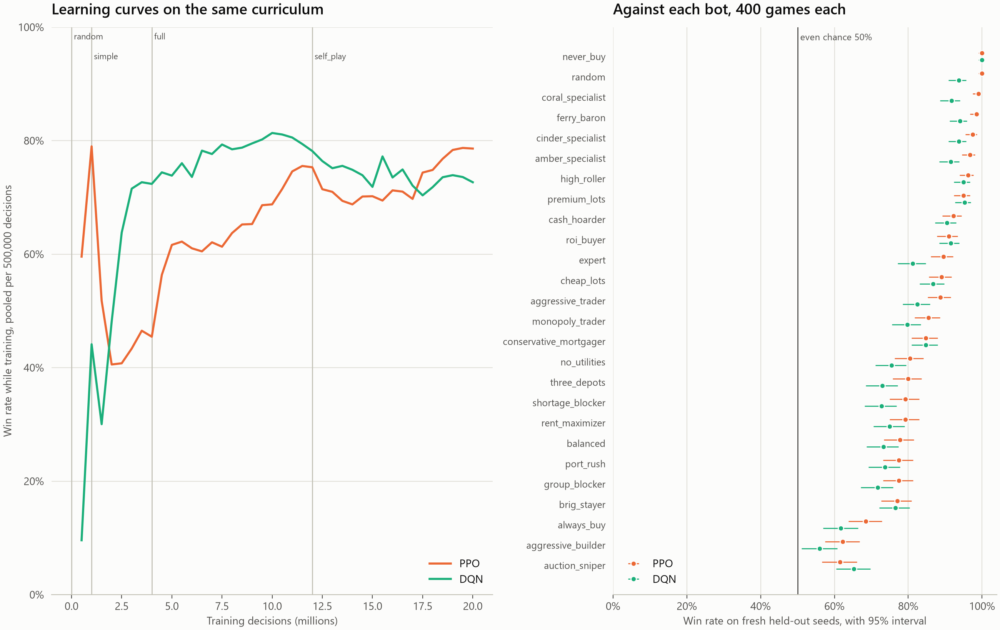

# Results

Saltmarket is an original Monopoly-style game, so these findings apply to Saltmarket and
should not be read as findings about Monopoly. Every number below comes from a file in
`results/`, named next to the claim.

This is version 2.0. The tournament now has 40 bots: the 26 the agents trained against
and 14 held-out bots that no agent ever saw. The agents were evaluated again on a new seed
set (v2) with 1,000 games against each bot. Version 1.0 results, with 26 bots and 400
games per bot, are summarized in [CHANGELOG.md](CHANGELOG.md) and kept in the `v1.0.0`
tag. A few v1 files are still cited below where nothing replaced them, and each one is
marked as v1.

## Key findings

1. **The PPO specialist is the strongest 2-player entrant of 41.** It won 82.0% of
   40,000 games against all 40 bots (95% CI 81.6–82.4), ahead of the best bots,
   `mortgage_flipper` at 78.5% (CI 78.2–78.8) and `auction_sniper` at 78.4% (CI
   78.1–78.7). It beat every bot head-to-head. Its lowest result is 57.7% (CI 54.6–60.7),
   against the held-out `leveraged_buyer`. It missed its original 90% target.
   `rl_eval_summary_two_player_v2_all.json`, `rl_vs_bots_two_player_two_player_v2_all.csv`,
   `rl_eval_two_player_two_player_v2_all.csv`, `figures/agent_vs_opponents.png`
2. **Against bots it never trained against, PPO's win rate falls by 10 points,** from
   85.6% (CI 85.1–86.0) against the 26 training bots to 75.4% (CI 74.7–76.1) against the
   14 held-out bots. The best training bot falls further on the same opponents, by 13.2
   points, so much of the drop is a harder pool. See "Unseen opponents".
   `rl_eval_summary_two_player_v2_all.json`, `pool_win_rates.csv`
3. **PPO beat DQN under identical training conditions.** A Double DQN agent trained the
   same way won 78.3% (CI 77.9–78.7), 3.7 points behind PPO. Both played the identical
   40,000 games, and a paired McNemar test gives p = 2.4 × 10⁻⁵¹. PPO also leads against
   the held-out bots alone, by 2.9 points (p = 4.4 × 10⁻¹⁰). See "PPO vs. DQN".
   `ppo_vs_dqn.json`, `figures/ppo_vs_dqn.png`
4. **A held-out bot is the strongest bot at 4 players and tied for first at 2.**
   `mortgage_flipper` won 49.6% at 4 players (CI 49.1–50.0), almost twice an even 25%
   share. At 2 players it won 78.5%, level with `auction_sniper` at 78.4%, and the
   intervals overlap. Held-out bots take the top three places at 4 players. `two_player_win_rates.csv`,
   `four_player_win_rates.csv`, `figures/win_rates.png`
5. **The best strategy depends on table size.** `auction_sniper` is 2nd at 2 players
   (78.4%) and 33rd of 40 at 4 (12.0%). `expert`, the bot designed to be best, is 24th at
   2 players (56.8%) but 4th at 4 (37.3%). `two_player_win_rates.csv`,
   `four_player_win_rates.csv`
6. **No agent clearly leads at 4 players.** The mixed PPO agent won 35.2% of 20,000
   4-player games (CI 34.5–35.8), 6th of 41. On decided games it falls to 20th, at 30.9%.
   `rl_vs_bots_four_player_main_v2_all.csv`
7. **Specializing mattered more than anything else tried.** The same PPO code trained on
   2-player tables only won 85.6% against the training bots at 2 players, against 70.5% for
   the mixed agent. Against the held-out bots the gap is 75.4% against 51.7%.
   `rl_eval_summary_two_player_v2_all.json`, `rl_eval_summary_main_v2_all.json`
8. **The agent found the auction trick on its own.** It accepts list price rarely, about
   1% of the time on cinder, crown, jade, and driftwood, yet it bids 85–166% of list price
   on average at auction. Winners only pay just over the runner-up's bid, so high bids can
   still be cheap. `rl_tendencies.csv`, `figures/agent_tendencies.png`

## Unseen opponents

The agents trained against 26 bots, so beating those bots does not show they can handle
new strategies. Fourteen more bots were written after training and kept out of every
training stage (`docs/strategies.md`, "Held-out bots"). No agent was retrained.

| Opponents | PPO | DQN | `auction_sniper` | `mortgage_flipper` |
| --- | --- | --- | --- | --- |
| 26 training bots | 85.6% (CI 85.1–86.0) | 81.4% (CI 81.0–81.9) | 83.2% (CI 82.8–83.5) | 80.4% (CI 80.1–80.8) |
| 14 held-out bots | **75.4% (CI 74.7–76.1)** | 72.5% (CI 71.8–73.3) | 70.0% (CI 69.4–70.5) | 74.7% (CI 74.1–75.2) |

Agents: 1,000 v2-seed games per bot (`rl_eval_summary_two_player_v2_all.json`,
`rl_eval_summary_dqn_two_player_v2_all.json`). Bots: 2,000 tournament games per pair
(`pool_win_rates.csv`). A bot's row leaves out its games against itself, which never
happen.

**The drop is real, but the pool is harder too.** PPO loses 10.1 points against unseen
bots. `auction_sniper`, the best training bot, loses 13.2 points against the same 14
bots. `mortgage_flipper` is itself held out, so its second row covers 13 bots.

**PPO did not win just because some held-out bots resemble training bots.** Three
held-out bots often play exactly like a training bot (`heldout_overlap.csv`, see
`docs/strategies.md`). Against those three PPO won 79.5% (CI 78.0–80.9). Against the
other eleven it won 74.3% (CI 73.5–75.1). The eleven distinct bots are harder, and PPO
still won more than half its games against every one of them. `heldout_split.csv`

**Hardest opponents for PPO** (`rl_eval_two_player_two_player_v2_all.csv`):

| Bot | Pool | PPO win rate |
| --- | --- | --- |
| `leveraged_buyer` | held out | 57.7% (CI 54.6–60.7) |
| `mortgage_flipper` | held out | 59.8% (CI 56.7–62.8) |
| `aggressive_builder` | training | 60.0% (CI 56.9–63.0) |
| `phase_shifter` | held out | 64.4% (CI 61.4–67.3) |
| `always_buy` | training | 67.2% (CI 64.2–70.0) |

Most of them spend aggressively in the land grab: they buy without a cash cushion,
mortgage to keep buying, or turn unusable lots into cash. A likely reason, not tested here, is
that cash-rich rivals make auctions less cheap, and PPO relies on cheap auctions (Key
finding 8).

## Which strategies win, and why

**`mortgage_flipper` exploits how other bots value spaces.** It mortgages lots it cannot
use and sells them to rivals near full price, because most bots value a space at list
price whether or not it is mortgaged. It beats `auction_sniper` in 60.9% of their
2-player games (`head_to_head.csv`). Unlike the sniper, it also wins at 4 players. This
is a flaw in the other bots' trade valuation, not a property of the game.

**Auctions are cheap at 2 players.** With one rival, a space often goes for little because
that rival has already spent its cash. At 2 players `mortgage_flipper` wins 8.8 auctions
per game at 15.8% of list price, and `balanced` wins 7.8 at 15.5%. At 4 players competing
bidders push both to about 70% of list price: 69.1% and 69.8%. `auction_prices.csv`

**Stalled games are common at 4 players.** 36.4% of 4-player games hit the 2,000-turn cap,
against 6.0% of 2-player games. At 4 players, 76.4% of capped games had no group earned,
against 0.25% of decided games. Spaces end up split between players, few bots trade, and
nobody builds. `tournament_summary.json`, `figures/game_length.png`

**The mixed agent gains from stalled games.** It reaches the cap in 48.5% of its 4-player
games and wins 39.7% of those, which lifts it from 20th on decided games to 6th overall.
Training counts a capped win as a full win, which is a likely cause, but this was not
tested. `rl_vs_bots_four_player_main_v2_all.csv`

**Building is strongly linked to winning.** At 2 players, win rate rises from 16.8% for
players who peaked at two depots to 57.4% at three and 79.4% at a port. At 4 players the
same steps are 0.6%, 15.8%, and 72.8%. This is an association, since players who are
already ahead can afford to build. `peak_level_win_rates.csv`,
`figures/building_level.png`

## Best groups

| Table size | Largest win-rate gap for earning a group | Highest rent per coin spent |
| --- | --- | --- |
| 2 players | driftwood, +36.1 points, and crown, +35.6 | reef, 2.27 |
| 4 players | crown, +51.0 points | reef, 6.74 |

Reef returns the most by a wide margin, which suggests it is underpriced in this board
design. Four-player returns run higher partly because long stalled games keep collecting
rent. Earning any group is linked to much higher win rates, but strong bots earn more
groups, so this does not prove the group caused the win. `two_player_group_value.csv`,
`four_player_group_value.csv`, `two_player_group_economics.csv`,
`four_player_group_economics.csv`, `figures/group_roi.png`

## PPO vs. DQN

A second agent was trained with Double DQN (dueling heads, experience replay, a target
network, epsilon-greedy exploration) to test whether the choice of algorithm matters.
It trained under the same conditions as the PPO specialist: 2-player tables, the same
curriculum and opponents, 20 million decisions, the same reward, and seed 0. Both played
the identical v2 schedule of 40,000 games, 1,000 against each of the 40 bots. Setup
details are in `docs/rl.md`. Source: `ppo_vs_dqn.json` unless another file is named.

**PPO is better.** The gap is small but clear.

| | PPO | DQN |
| --- | --- | --- |
| Win rate, all 40 bots | 82.0% (CI 81.6–82.4) | 78.3% (CI 77.9–78.7) |
| Win rate, decided games | 83.8% (CI 83.4–84.2) | 80.1% (CI 79.7–80.5) |
| Win rate, 26 training bots | 85.6% (CI 85.1–86.0) | 81.4% (CI 81.0–81.9) |
| Win rate, 14 held-out bots | 75.4% (CI 74.7–76.1) | 72.5% (CI 71.8–73.3) |
| Games reaching the turn cap | 5.3% | 4.1% |
| Rank among the 40 bots plus itself | 1st | 3rd, close behind `mortgage_flipper` and `auction_sniper` |
| Bots it beats significantly more often than the other agent does (p < 0.05) | 24 of 40 | 0 of 40 |
| Training time | 1,206 s | 2,467 s |
| Decisions per second | 16,606 | 8,109 |

**Significance.** The two agents played the same games, so each game gives a pair of
outcomes. McNemar's test uses only games the agents split. PPO won 5,533 games that DQN
lost, and DQN won 4,056 that PPO lost.

| Opponents | Difference (PPO − DQN) | Bootstrap 95% interval | McNemar p | z-test p |
| --- | --- | --- | --- | --- |
| All 40 bots | 3.7 points | 3.2 to 4.2 | 2.4 × 10⁻⁵¹ | 3.6 × 10⁻³⁹ |
| 26 training bots | 4.1 points | 3.5 to 4.7 | 2.9 × 10⁻⁴⁸ | 1.1 × 10⁻³⁶ |
| 14 held-out bots | 2.9 points | 1.9 to 3.9 | 4.4 × 10⁻¹⁰ | 3.2 × 10⁻⁸ |

The z-test and the bootstrap treat the two samples as independent, which ignores the
pairing, so they are conservative here. On decided games only, PPO leads by 3.7 points
(bootstrap 3.2 to 4.2).

**Per opponent** (`ppo_vs_dqn_per_opponent.csv`): PPO's largest advantages are against
`stalemate_seeker` (78.5% vs. 69.0%), `aggressive_builder` (60.0% vs. 52.1%), and
`no_utilities` (82.0% vs. 74.3%). DQN's best result relative to PPO is against
`mortgage_flipper`, 63.4% vs. 59.8%, which is not significant (p = 0.098). DQN's lowest
result, 52.1% against `aggressive_builder` (CI 49.0–55.2), is the only one whose interval
reaches 50%. `rl_eval_two_player_dqn_two_player_v2_all.csv`. These 40 per-opponent tests
are not corrected for multiple comparisons.

**At 4 players,** where neither agent trained, the v1 evaluation (26 bots, 10,000 games)
found DQN won 17.9% (CI 17.2–18.7) against PPO's 37.1%. DQN carries over to a new table
size much worse. This was not rerun for v2. `rl_eval_summary_dqn_two_player_fresh.json`,
`rl_eval_summary_two_player_fresh.json` (v1)

**Sample efficiency has no clean winner.** No intermediate PPO weights were saved, so
the only learning curves are training win rates. These are not a fair skill measure:
PPO's training games sample from its probabilities, while DQN plays its best action
98% of the time after the first 10% of training. Each agent's self-play opponents are
also its own earlier versions. With that caveat, pooled per 500,000 decisions
(`ppo_vs_dqn_learning_curves.csv`):

| Stage | PPO training win rate | DQN training win rate |
| --- | --- | --- |
| `random` (0–1M) | 75.9% | 31.1% |
| `simple` (1–4M) | 43.0% | 62.3% |
| `full` (4–12M) | 67.9% | 78.4% |
| `self_play` (12–20M) | 73.2% | 73.8% |

After the full bot pool arrives at 4M decisions, DQN first reached 70% at 4.5M and PPO at
10.5M. DQN's curve peaked at 81.4% around 10M and then fell, and it ended at 72.7% in the
last bin against PPO's 78.6%. DQN learned faster in the middle of training, which is what
data reuse should give, but PPO ended stronger when both play greedily.

**Wall-clock time.** DQN took 2.0 times as long. In the training log, the median round
took 1.10 seconds in rounds 1–1,000 and 1.33 seconds after, and a median 0.75 and 0.85
seconds of that went to 80 small gradient steps in a row on the GPU. DQN also sends the
next observation with every transition, so more data moves between processes. Other
sessions were using the CPU during part of DQN training, so the timing is approximate.
These figures leave out DQN's first run, which reached 4.88M decisions before it was
stopped (see below). `training_log_dqn_two_player.csv`

**Likely reasons DQN lost.** These are explanations, not tested causes.

- **Long games, sparse reward.** A game lasts hundreds of decisions and the win arrives
  at the end. DQN passes value back 8 decisions per bootstrap step. PPO's advantage estimate
  looks over long stretches of real outcomes at once.
- **Close Q-values may make greedy play brittle.** If the legal actions in a state have
  similar Q-values, small errors can flip the argmax. Neither this nor the other reasons
  here were measured.
- **Shifting opponents.** The curriculum and self-play change the opponents, so replayed
  experience goes stale. PPO learns only from fresh data.
- **Exploration.** Epsilon-greedy explores with uniformly random legal moves, such as
  random bids or mortgages, rather than near-good alternatives.

**This compares two trained agents, not two algorithms in general.** Each was trained
once with seed 0, and neither had its settings searched, so the variation between runs
is unknown. DQN also needed one fix. Its first run stalled at an 11–25% training win rate,
because the value head started with large made-up values (the average Q-value was still
0.79 at 4.1M decisions) and the target network refreshed too rarely to correct them. Those two settings were fixed, and the second run is the one reported.
`training_log_dqn_two_player_attempt1.csv`, `docs/rl.md`

## Methodology

| Stage | Size | Source |
| --- | --- | --- |
| Rules fuzz test | 10,000 random-bot games, invariants checked every turn | `fuzz_summary.json` |
| Bot fuzz test | 26 bots × 1,000 mixed-table games | `bot_fuzz.csv` |
| Held-out bot fuzz test | 14 bots × 1,000 games at tables drawn from all 40 bots | `bot_fuzz_heldout.csv` |
| Held-out overlap check | 40 bots × 520 games, compared by full event log | `heldout_overlap.csv` |
| Landing check | 1,863,535 rolls against an exact Markov chain, 0.16% total variation distance | `landing_summary.json` |
| 2-player tournament | 1,560,000 games: 40 bots, 780 pairs, 2,000 per pair, seats alternated | `tournament_summary.json` |
| 4-player tournament | 500,000 games: 125,000 tables of 4 of the 40 bots, in all four rotations | `tournament_summary.json` |
| Agent training | Two PPO runs and one DQN run of 20 million decisions | `training_log_main.csv`, `training_log_two_player.csv`, `training_log_dqn_two_player.csv` |
| Agent evaluation, v2 | 40,000 2-player games per agent, 1,000 against each bot. The mixed agent also played 20,000 4-player games | `rl_eval_summary_*_v2_all.json` |

The tournament played 2,060,000 games and 861,572,594 player turns
(`tournament_summary.json`). Its win rates have 95% Wilson intervals no wider than
±0.35 points at 2 players and ±0.44 points at 4 players. Ratings use a Bradley-Terry fit
on an Elo scale, from 2-player games only (`ratings.csv`, `figures/ratings.png`).
`mortgage_flipper` (1810.2) and `auction_sniper` (1809.6) are effectively tied at the top.
Rotating seats matters: the 4-player first seat wins 27.0% and the last 22.9%
(`four_player_seats.csv`).

**A matchup is one complete game.** The agent takes its most likely legal action. The v2
evaluation seeds start at 9,300,000,000. They cannot occur in training, and a test checks
that they overlap no earlier evaluation set. See `docs/rl.md`.

## Limitations and threats to validity

- **Held-out opponents are a small, hand-written set.** The 14 unseen bots were written
  by the same author as the training bots, after training, and were not tuned against
  the agents. Three of them often play exactly like a training bot
  (`heldout_overlap.csv`), and results are also reported without them. Truly different
  opponents, such as people, could do better against the agents. At 4 players the only
  test against unseen bots is the mixed agent's random tables, which mix both pools.
- **One training run per setup.** Each agent comes from a single seed, so how much results
  vary between training runs is not measured. This includes the PPO vs. DQN comparison.
- **Little tuning.** Hyperparameters were not searched, and I did not test whether reward
  changes or longer training would help.
- **The bot pool shapes every ranking.** Win rates depend on which bots are in the pool,
  and the bots were hand-written for this project. Adding the 14 held-out bots changed
  the rankings a lot. For example, `auction_sniper` was 17th of 26 at 4 players in v1
  (CHANGELOG.md) and is 33rd of 40 now.
- **Agent and bot figures are close but not identical comparisons.** A bot's tournament
  games exclude itself, while the agent faces all 40 bots, and the agent's games use
  their own seeds.
- **Capped games are decided by net worth.** Results are reported with and without them
  for this reason.
- **The agent has a limited action set.** It proposes only cash offers for a group's
  missing lots, cannot propose swaps, and bids in fixed steps.
- **Rule simplifications.** Auctions take one maximum bid per player, and there is no
  auction for the last depots during a shortage.
- **Group and building results are associations,** not causal effects.
